# Investment Research Agent: System Overview

Oct 29, 2026 · Steps: [02-implementation-plan.md](02-implementation-plan.md) · Background: [투자 리서치 에이전트 설계](<../투자 리서치 에이전트 설계.md>), [애널리스트 관점](<../애널리스트 관점.md>)

Every weekday the system pulls filings and news for my holdings, watchlist and 4 sectors. It emails an English report at 08:00, 16:30 and 22:00, plus an earnings deep-dive at 22:00 on earnings days. Each report answers one question: *what new evidence strengthened or weakened my thesis, and what should I check next?* The pilot covers only the morning report for GOOG, META and RDDT.

The system never trades. Code computes every number, and the LLM only writes the sentences.

## Architecture

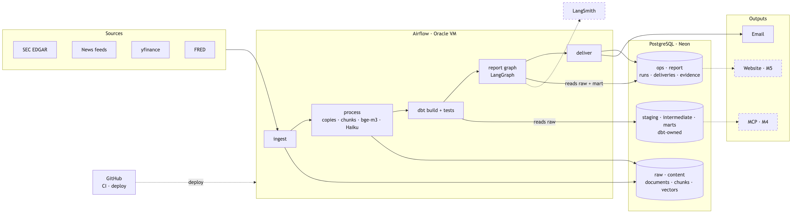

| Part | Does |
| --- | --- |
| Airflow on an Oracle VM | Schedule, task order, retries, alerts |
| Python (`invest` CLI) | Fetching, parsing, chunking, embeddings, summaries, run state, report evidence |
| dbt | Normalizes data, applies business rules, builds the tables that services read, runs data tests |
| Postgres on Neon | All data |
| GitHub (public repo) | Code, config, dbt models, migrations, tests, evals; runs CI and deploys. No data, secrets or personal files |

## One run

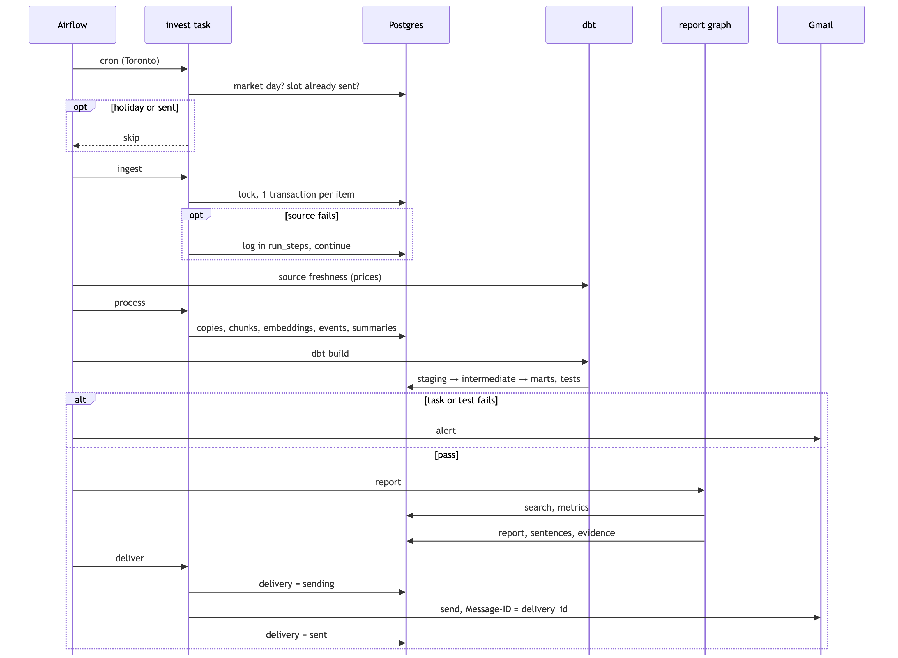

Each step's remaining work is whatever still lacks its output row, so a rerun after a crash skips finished work.

| Step | Remaining work | One transaction writes | After a crash |
| --- | --- | --- | --- |
| ingest | Items in the source's lookback window that aren't stored yet ([late arrivals](#late-arrivals)). Sources run in parallel | Document + version | Refetched; `ON CONFLICT` adds nothing |
| process | Canonical current versions with no chunks for the active chunker, or no summary for the active prompt | Chunks, new embeddings and event link, or the summary | Only documents in flight are redone. Summaries run 5 at a time, so at most 5 LLM calls repeat |
| dbt build | — | `staging`, `intermediate`, `marts` | Rebuilt |
| report | Slot has no final report | Report, sentences, claims, evidence | Regenerated (≈ $0.15) |
| deliver | Slot has no sent delivery | Delivery row | See [Delivery](#delivery) |

- All pipeline tasks share a 1-slot Airflow pool.
- Each `invest` command takes a Postgres advisory lock over a direct connection, not the pooler, so a manual CLI run can't overlap a scheduled one.
- An item that fails 3 times is skipped until its processor version changes.

## Late arrivals

Sources publish late, and late items carry earlier timestamps. On Oct 29, RDDT's results came out at 16:08 ET. Finnhub listed none of the 16 articles about it until hours later, all timestamped 16:07–19:33.

| Source | Measured delay (F1) | Lookback |
| --- | --- | --- |
| SEC 8-K | Earnings 8-Ks accepted 16:01–16:08 ET. API delay measured in F2 | 1 day |
| IR RSS | Release on the site within a minute of the 8-K | 1 day |
| Alpaca | Benzinga flash headlines 2 min after the release. Free keys may lag 15 min | 6 h |
| Finnhub | 2–5 h after the article's timestamp | 2 days (the API takes dates) |
| yfinance ratings | Same day | 3 days |
| Transcripts | Alpaca the same day; Alpha Vantage 1–8 days | Polled daily until found, up to 14 days |

1. **A window, not a watermark.**
   - Each run asks every source for the window starting at the source's last successful run minus its lookback, up to now. It skips what it already has, by unique source ID.
   - A watermark on `published_at` would silently drop every late item.
   - After a missed run or a weekend, the window reaches back to the last successful run on its own.
2. **Reports pick by first seen, not by published.**
   - A document's `created_at` is when we first saw it. A report covers documents first seen since the previous report's cutoff.
   - An article published at 16:07 and first seen at 21:12 goes into the 22:00 report.
   - If it was published before the previous report's cutoff, the report says so: "(published 16:07, seen 21:12)".
   - Items published more than 7 days before they're seen go to search only.
3. **Primary sources first on earnings days.**
   - Earnings dates and before- or after-market timing come from Finnhub's earnings calendar (free) and yfinance.
   - On those days the `earnings_watch` DAG polls SEC, IR RSS and Alpaca every 10 minutes through the release window (after market 15:55–18:30 ET, before market 06:00–09:00 ET), and Finnhub every 30 minutes.
   - The close run waits until 16:25 for the 8-K or release (an Airflow sensor in reschedule mode). If neither has arrived, the report says the results aren't out.
   - The 22:00 earnings deep-dive is built on the 8-K, the release and the same-day transcript. It states how many news articles had arrived when it was written.
4. **Delay is measured.**
   - `fct_source_lag_daily` holds, per source and day, the count and the p50/p95 of `created_at − published_at`.
   - A test warns when a source's p95 nears its lookback, because items could then fall outside the window.
   - It also warns when a tracked ticker has no news 3 hours after its earnings release.

## Sources for M1

Measured in F1 ([source probe](source-probe.md)).

| Source | Gives | Full text | Limit |
| --- | --- | --- | --- |
| SEC EDGAR | Filing list with 8-K Items (submissions API), filing HTML and exhibits (Archives), GAAP facts (XBRL API, no segments) | Yes, from Archives | 10 req/s |
| Company IR RSS | Release title and link (`/rss/pressrelease.aspx`) | From the release page | — |
| Finnhub company news | Headline, ~22-word snippet, link, outlet | From the publisher page: 58% `full` over 30 days | 60/min. About 250 items per call, so one call per ticker per day |
| Alpaca News | Benzinga articles with content, earnings headlines within minutes, call transcripts the same day | `content` on about 70% | 200/min |
| yfinance | Prices, rating and target changes, estimates, earnings dates | — | Unofficial, can break. Rating data has errors |
| Alpha Vantage | Earnings call transcripts (backup) | Yes, verbatim with speakers, 1–8 days after the call | 25/day |
| FRED | Rates, CPI, unemployment, dollar index | — | — |

Dropped in F1:
- Google News RSS: robots.txt
- GDELT: 429
- Tiingo, EODHD, FMP: free plans don't cover our use
- TipRanks: no storage allowed
- Reddit: its API stops accepting new applications on Oct 31, 2026

### News bodies

Finnhub only finds articles. The body comes from the publisher's own page, or from Alpaca for Benzinga, which blocks our fetches.

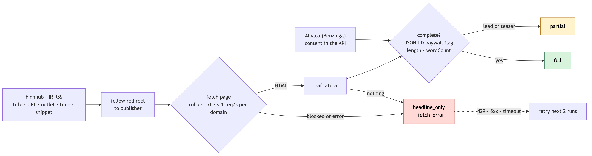

| `body_status` | Means | May be used for |
| --- | --- | --- |
| `full` | Whole article extracted | Search, analysis, quotes |
| `partial` | Lead only, paywall teaser, or truncated | Quotes from the extracted part only. The report marks the source "(partial)" |
| `headline_only` | Title only. `fetch_error` holds the reason if the fetch failed | Discovery, event grouping, a link, and quoting the headline. Nothing about the article's reasoning, quotes or numbers |

- **Completeness check.** An article is `partial` if its JSON-LD says `isAccessibleForFree: false`, if it has fewer than 150 extracted words, if a paywall phrase appears, or if the extracted words are under 70% of the JSON-LD `wordCount`. These are starting values; F1 tunes them.
- **Fetching.** Obey robots.txt (RFC 9309), make at most 1 request per second per domain with one request in flight, and send a User-Agent that names the project. Different domains are fetched in parallel.
- **Retries.** A transient error (429, 5xx, timeout) is retried on the next 2 runs.
- **What we don't do.** No paywall bypass. No headless browser unless F1 shows a key publisher needs one.
- **Two kinds of summary.** The feed's snippet goes in `feed_snippet`, our Haiku summary in `content.summaries`. They stay separate. Only `full` and `partial` versions are summarized.
- **Display.** Full article text is stored for search only. The website and MCP show short quotes and links.

## Storage

One PostgreSQL 18 database with pgvector 0.8.6, on Neon Free.

| Schema | Owner | Holds | Rebuildable |
| --- | --- | --- | --- |
| `raw` | Python | Documents, versions, prices, XBRL facts, ledger, universe | No |
| `content` | Python | Chunks, embeddings, summaries, events, extracted facts | Only by paying for LLM calls and embeddings again |
| `ops` | Python | Runs, steps, cursors, failures, dbt invocations, deliveries | No |
| `report` | Python | Reports, sentences, claims, calculations, evidence | No; append-only |
| `staging`, `intermediate`, `marts` | dbt | Models | Yes |

Roles:
- `dbt` reads `raw`, `content`, `ops` and `report` (for the evidence test), and owns its three schemas.
- `app` and `reader` (MCP, website) read only `marts`.
- Quotes and search go through `content.search_chunks` and evidence joins.
- Broker files are imported into `raw.ledger_entries` and never committed.
- Holdings come only from the ledger. `universe.yaml` never marks which tickers I hold.
- Theses and `investment_policy.md` live in the gitignored `private/` folder. `invest theses sync` stores each changed file as a new row in `raw.thesis_versions`.

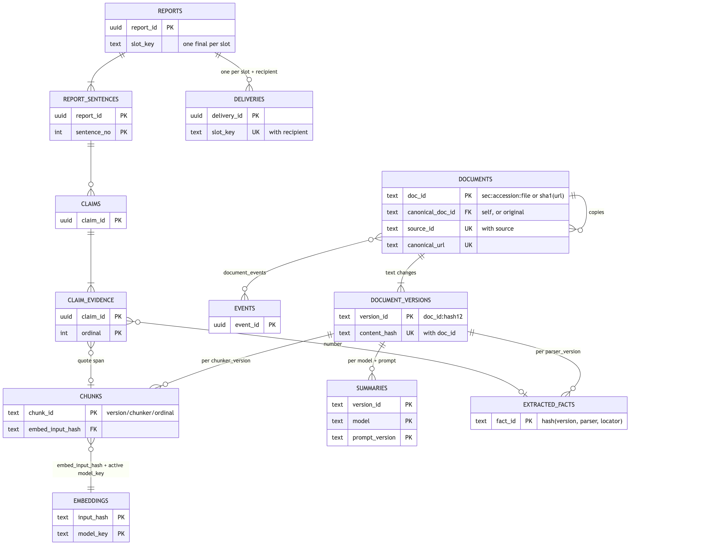

| Table | One row per | Main columns |
| --- | --- | --- |
| `raw.documents` | Document: `sec:<accession>:<file>` or `sha1(canonical_url)`. Unique `(source, source_id)` and `canonical_url` | `canonical_doc_id`, `doc_type`, `form_type`, `items[]`, `fiscal_period`, `tickers[]`, `sectors[]`, `source_rank`, `published_at`, `current_version_id` |
| `raw.document_versions` | Document × content hash (`doc_id:hash[:12]`) | `text` (target of all offsets), `body_status`, `fetch_error`, `feed_snippet`, `extractor`, `raw_gz`, `fetched_at` |
| `raw.prices_daily` | Ticker × date × source | |
| `raw.xbrl_facts` | CIK × concept × unit × period × accession | |
| `raw.ledger_entries` | Broker row (hash) | `kind`, `qty`, `amount`, `currency` |
| `content.chunks` | Version × chunker version × ordinal | `section_path[]`, `item_code`, `speaker`, `context_header`, `text`, `char_start`, `char_end`, `table_json`, `embed_input_hash` |
| `content.embeddings` | Embed input hash × `model_key` | `dense halfvec(1024)`, `sparse sparsevec(250002)` |
| `content.summaries` | Version × model × prompt version | |
| `content.document_events` | Document × event | |
| `content.extracted_facts` | Version × parser version × table cell | `metric`, `period_start`, `period_end`, `period_type`, `segment`, `basis`, `unit`, `scale`, `value` |
| `ops.runs` / `ops.run_steps` | Run / run × step | `slot_key` (`morning:2026-10-30`), Git SHA, config hash |
| `ops.dbt_invocations` | dbt invocation | `run_id`, command, `run_results` |
| `ops.deliveries` | Slot × recipient | `status`, `attempts`, `message_id` |
| `report.*` | Report; report × sentence; claim; claim × ordinal | One `final` report per slot |

- **Run columns.** Every Python output row has `run_id` and `created_at`. Python tables enforce real PK, FK, unique and check constraints. dbt `relationships` tests cover only links with no FK: evidence rows pointing at different tables, and chunk → active embedding.
- **Embedding lookup.** A chunk's embedding is the row in `embeddings` with the chunk's `embed_input_hash` and the active `model_key`. The hash covers header + text only. Model-specific prefixes are part of `model_key`. Each report records the `model_key` it searched with.
- **Time columns.** `published_at` is what the source states. `created_at` on `raw.documents` is when we first saw the document, and reports select by it. `fetched_at` is when a version's body was fetched. `as_of` is the report's cutoff. `known_from` / `known_to` mark when a resolved fact was valid.
- **No in-place updates.** Documents, versions and chunks are never updated in place, so a quote cited in an old report still resolves.

**Ledger.** One row for every cash movement, not just trades: deposits, withdrawals, FX, dividends, withholding tax, splits and fees. Without them, returns and drawdown come out wrong.

**Numbers from filings.** A number is saved only if it appears at the stated place in the filing *and* its metric, period, unit and GAAP/non-GAAP basis match the table headers. The same figure can appear as revenue, as EPS, or as last year's value.

**Size.** These are estimates. F6 replaces them with measured bytes per chunk.
- Pilot: ~35k chunks (0.3 GB) a year, which fits Neon Free's 1 GB.
- After expansion: ~200k chunks (1.6 GB) a year, which needs Neon Launch at about $5/month. Launch costs $0.106 per CU-hour and $0.35 per GB-month, with no minimum.
- Assumptions: ~60 documents a day in the pilot, 5× after expansion, ~8 KB per chunk.

**Raw files.**
- News HTML is kept gzipped for 30 days.
- SEC HTML isn't stored, because EDGAR serves it by accession.
- Raw files move to Oracle Object Storage (20 GB free) only if news HTML has to be kept longer than 30 days, raw bytes exceed 25% of the database, or PDFs or audio arrive.

## Lineage

| Question | Answered by |
| --- | --- |
| Which version does this chunk belong to? | PK/FK constraints (data model above) |
| Which models build `fct_financial_metrics`? | dbt `source()`/`ref()`, `manifest.json` |
| What data and code produced sentence 7 of the Oct 30 report? | `run_id` and versions on each row, `report.claim_evidence` |

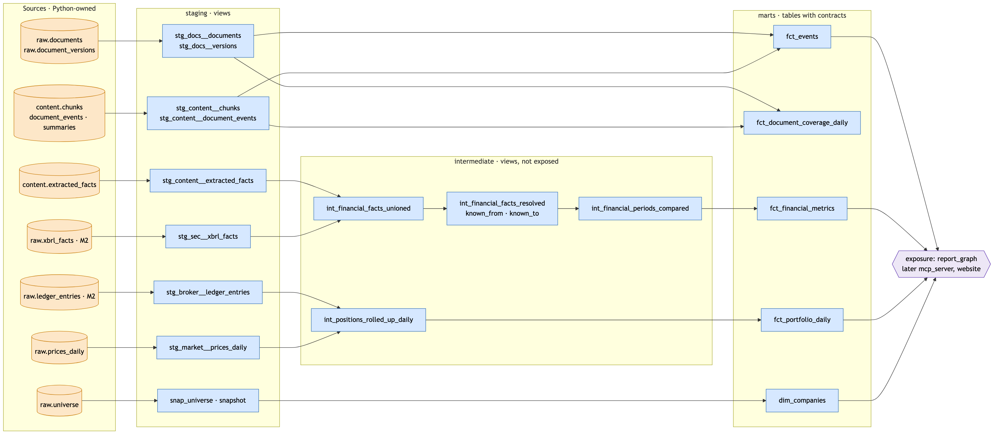

| Layer | Schema · materialization | Does | Name |
| --- | --- | --- | --- |
| Sources | `raw`, `content`, `ops` (Python) | — | `sources.yml` |
| Staging | `staging` · view | One source table each: rename, cast, units, time zones. No joins. The only layer that calls `source()` | `stg_<source>__<entity>s` |
| Intermediate | `intermediate` · view, not granted to services | Combine sources, pick one fact, align periods, shared calculations | `int_<entity>s_<verb>s` |
| Marts | `marts` · table with an enforced contract | Stable tables for the report graph, MCP, website | `fct_*`, `dim_*` |

- **References.** Models refer to each other only through `ref()`. CI fails any model that names a schema directly.
- **Business rules.** Source priority, growth rates and Q4 derivation are each written once, in `intermediate`.
- **Contracts.** A mart's contract fixes column names, types, not-null and primary key. A breaking change gets a new model version and a transition period.
- **Exposures.** They declare who reads which mart: `report_graph` now, `mcp_server` in M4, `website` in M5.
- **History.** `snap_universe` (a dbt snapshot) keeps watchlist history. Each report stores the `raw.thesis_versions` IDs it used and the code's Git SHA.
- **Artifacts.** Each dbt invocation stores `run_results.json` in `ops.dbt_invocations`. `manifest.json` is saved once per Git SHA in Object Storage.
- **Python steps.** dbt doesn't see inside Python steps. There, lineage comes from input IDs, processor versions and `run_id` on each output row.

**Financial facts.**
- `int_financial_facts_resolved`: one row per company × metric × period × period type × segment × basis × unit × `known_from`. `known_to` is set when a later filing replaces the fact.
- `facts_lookup(as_of)` returns only facts known at the report's cutoff, so an amendment filed later never changes what an old report knew.
- Source priority: XBRL from 10-Q/10-K, then the 8-K Exhibit 99.1 table, then the press release.
- `period_type` is quarter, ytd, annual or instant. Q4 = FY − 9M YTD for additive flow metrics only. EPS and balance-sheet items are never derived.
- Consolidated and segment values are separate rows. A null `segment` means consolidated.

## Chunking

The embedding input is a context header plus the chunk text. The header is stored separately, so a quote is always source text.

| Type | Unit | Header example |
| --- | --- | --- |
| 10-Q / 10-K | Part › Item › subheading; 350–450 tokens; split at paragraphs, never across sections | `GOOG · 10-Q · FY2026 Q3 · Part I › Item 2 MD&A › Revenues` |
| 8-K | Each Item; Exhibit 99.1 handled as a press release | `RDDT · 8-K · Items 2.02, 9.01 · Item 2.02` |
| Press release | Headings (highlights, quotes, outlook, tables, non-GAAP reconciliation); a quote keeps its speaker | `META · Q3 2026 earnings release · Outlook` |
| Table | One per chunk. A large table is split by row groups, and each part repeats the title, unit, header rows and parent row labels | `GOOG · 8-K Ex 99.1 · Consolidated statements of income · in millions · Q3 2025, Q3 2026` |
| Transcript | One speaker turn; in Q&A, the question plus all its answers | `META · Q3 2026 call · Q&A · <analyst> (<firm>) → <name>, CFO` |
| News, `full` or `partial` | Paragraphs, 350–450 tokens, only from the extracted text | `META · Reuters · 2026-10-29 · <headline>` |
| News, `headline_only` | One chunk containing only the title. The feed snippet goes in the header, so it is searchable but can't be quoted | `META · Reuters · 2026-10-29 · <feed snippet>` |

- **Tables.** The title comes from the nearest caption above the table. The unit comes from lines like `(in millions, except per share amounts)`. Multi-row headers collapse into one period per column. `table_json` keeps the same structure for the fact parser.
- **Location.** `char_start` and `char_end` slice `document_versions.text`, and a test checks that the slice equals the chunk text. Inline-XBRL element IDs are kept as anchors. Amendments (8-K/A, 10-Q/A) are separate documents.
- **Summaries are not chunks.** They aren't source text, so they can't pass the quote check.

`config/pipeline.yaml` sets the active versions. Old outputs stay, so cited reports still resolve.

| Change | Reruns |
| --- | --- |
| Fetched text | New version → chunk, embed, summarize and parse that version |
| Extractor | Extraction (SEC refetched, news from `raw_gz`). A new version only if `content_hash` changes |
| Chunker or header template | Rechunk. A chunk whose `embed_input_hash` didn't change keeps its embedding |
| Embedding model | Re-embed under a new `model_key`, then switch after the backfill |
| Summary prompt | Only the range you choose |
| Fact parser | Filing tables |

## Copies and events

| | Syndicated copy | Same event, different article |
| --- | --- | --- |
| Example | Reuters story reposted on Yahoo Finance | Reuters and Bloomberg on the same 8-K |
| Test | Same normalized text, or 5-word-shingle containment ≥ 0.8, within 72 h, shared ticker. Headline only: same normalized title within 48 h | Title + lead cosine ≥ 0.9, within 72 h, shared ticker |
| Result | Linked to its original; no chunks, summary or embedding | Both kept and searchable, sharing an `event_id` |
| Cost of a mistake | A lost article. Target: 0 false copies | Less variety in the top 8 |

The first copy to arrive becomes the original, with two exceptions:
- A filing exhibit that matches an earlier press release or news story becomes the original.
- A `full` copy replaces a `headline_only` or `partial` original.

The replaced document leaves search, but its chunks are kept. Within an event, Research reads `full` members first.

## Search

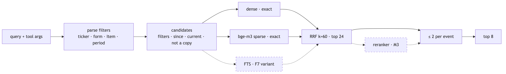

- **Filters, not search terms.** Ticker, form, Item number and fiscal period are filters. "RDDT 8-K Item 2.02" becomes `tickers=[RDDT], forms=[8-K], items=[2.02]`.
- **Parser filters.** A regex parser adds any filters the model left out. If those parser filters return nothing, the search runs once more without them.
- **Items and periods.** For 8-Ks, `items` matches the filing's Items from EDGAR, which brings in Exhibit 99.1. For 10-Q/10-K it matches the chunk's Item. `period` applies to filings and releases only; news is filtered by date.
- **Ranking.** Exact bge-m3 dense and sparse scores are computed over the filtered rows. RRF (k=60) merges them, and results are capped at 2 chunks per event.

Postgres full-text search doesn't replace bge-m3 sparse:

| | bge-m3 sparse | Postgres FTS |
| --- | --- | --- |
| Term weight | Learned per token | Term frequency; no IDF ("ranking functions do not use any global information") |
| Matching | Any shared token scores | `websearch_to_tsquery` requires every word, so long questions often match nothing |
| Good at | Rare terms inside a question | Exact phrases, names |

FTS and an HNSW index are added only if the F7 benchmark shows a gain.

## Report graph

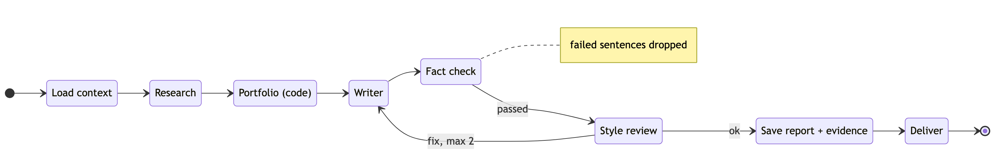

| Node | Model | Tools |
| --- | --- | --- |
| Load context | code | `holdings()`, calendar, documents first seen since the last sent report |
| Research | Sonnet 5.5, temp 0.2 | `search_chunks`, `price_quote`, `facts_lookup(as_of)` |
| Portfolio | code | `pnl_attribution`, `beta`, `risk_contribution`, `rule_check` |
| Writer | Sonnet 5.5 (Opus 5.5 on earnings days), temp 0.6 | none; numbers only from `metrics` |
| Fact check | code + Sonnet 5.5, temp 0 | number comparison, quote matching |
| Style review | Sonnet 5.5, temp 0 | none |

A sentence that fails the fact check is dropped, not rewritten. Only style problems go back to the Writer, and every rewrite is fact-checked again.

## Fact-check rules

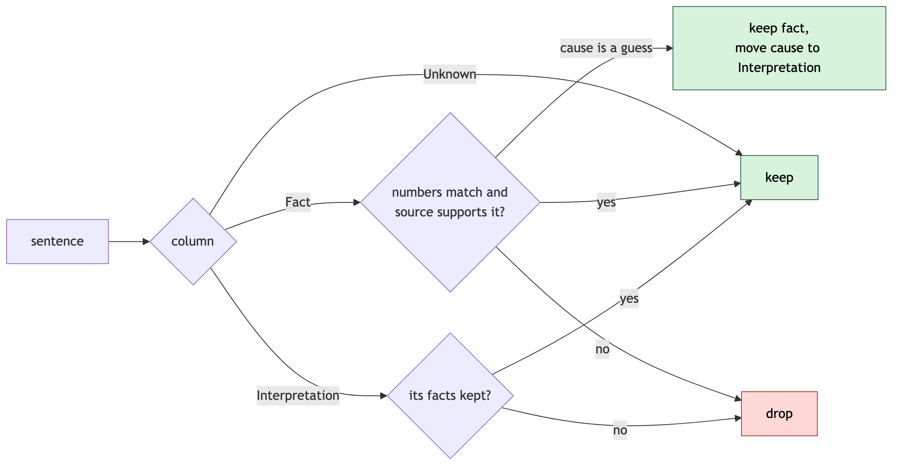

An unverified fact can't be saved by relabelling it as interpretation. A claim backed only by a `headline_only` chunk can say no more than "<outlet> reported: <headline>". Each dropped sentence leaves a line at the end of the report, for example: `[Excluded] RDDT Q4 guidance: source unit (millions) ≠ extracted unit (billions)`.

## Evidence

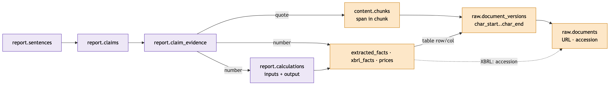

- Evidence points only at rows Python owns. dbt may rewrite its own rows on the next build.
- A number taken from a mart is copied into `report.calculations` along with its input row IDs, the mart, the dbt invocation and `as_of`.

## Delivery

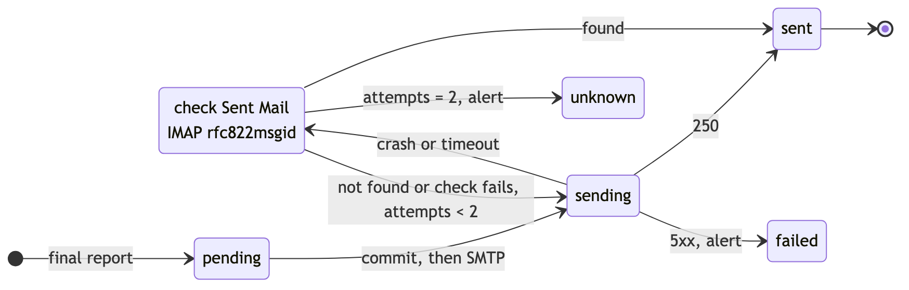

1. Insert `ops.deliveries (slot_key, recipient)` and commit. The unique key blocks a second row for the same slot.
2. Send with `Message-ID: <delivery_id@invest-agent>`. On `250`, mark `sent`. On a 5xx, mark `failed` and alert.
3. A crash during the send leaves the row at `sending`. The next run searches Gmail's Sent Mail over IMAP (`X-GM-RAW "rfc822msgid:<id>"`).
   - Found → `sent`.
   - Not found → resend once.
   - Still unclear → `unknown` and alert.

The only recipient is me, so a duplicate costs less than a missing report.

## Deployment and schedule

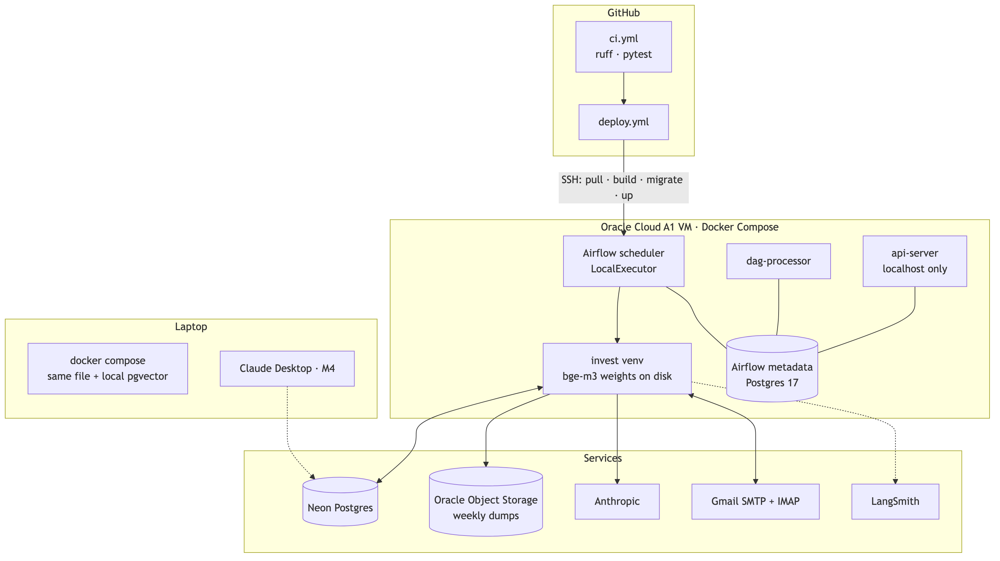

**The VM.** One Oracle Cloud Always Free Ampere A1 VM (2 OCPU, 12 GB, ARM) runs Docker Compose:
- Airflow 3.3 with LocalExecutor
- Postgres 17 for Airflow's metadata
- The app, in its own virtualenv so its dependencies can't clash with Airflow's

**Deploys.** A push to `main` runs CI, then deploys over SSH: `git pull`, `docker compose build`, `invest db migrate`, `docker compose up -d`. The image is built on the VM because it's ARM and too big for the free 500 MB GitHub Packages quota.

**Access.** Runtime secrets live in `.env` on the VM. The Airflow UI listens on localhost only and is reached through an SSH tunnel.

| Report | Arrives | Airflow cron (America/Toronto) |
| --- | --- | --- |
| Morning | 08:00 | `40 7 * * 1-5` |
| Close | 16:30 | `10 16 * * 1-5` |
| After-hours | 22:00 | `40 21 * * 1-5` |

- A time-zone-aware Airflow cron follows daylight saving, so each report needs one cron.
- On a tracked ticker's earnings day, `earnings_watch` runs every 10 minutes through the release window, and the close run waits until 16:25 for the release ([late arrivals](#late-arrivals)).
- The first task skips market holidays and slots that were already sent.
- If the VM is down, that report is skipped. The VM can be rebuilt from the repo. Airflow's metadata DB holds only run history.

## Stack

| Part | Choice |
| --- | --- |
| Database | PostgreSQL 18 + pgvector 0.8.6, Neon Free (Docker locally) |
| Transform | dbt Core 1.12 + dbt-postgres |
| Orchestration | Airflow 3.3, LocalExecutor |
| Runtime | Oracle Cloud A1 VM (Always Free), Docker Compose; the same compose file on the laptop |
| CI/CD | GitHub Actions: ruff, pytest, dbt build on fixtures, deploy over SSH |
| Embedding | bge-m3 on CPU, dense + sparse in one pass |
| LLM | Haiku 5.5 to summarize, Sonnet 5.5 for reports, Opus 5.5 for earnings. Final choice after the M3 A/B test against OpenAI |
| Agent | LangGraph + LangChain |
| Tracing | LangSmith |
| Delivery | Gmail SMTP; IMAP for unclear sends |
| Budget | About $12–15 a month, all LLM; infrastructure is free in the pilot |

## Why this setup

**Postgres instead of Qdrant + DuckDB + data files in Git**
- State in three stores had no shared transaction. A crash between the Qdrant upsert and the Git commit left them out of sync. An email sent before a failed commit could go out again.
- DuckDB was rebuilt every run, so processing state had to be committed to Git.
- At ~200k chunks, exact vector search over filtered rows should be fast enough. F7 measures it.

**Costs we accept**
- Neon Free has 1 GB, against Qdrant's 4 GB of free disk.
- Backups are ours, since Neon Free keeps 6 hours of history.
- If Neon is down, nothing runs.
- Once HNSW is needed, pgvector filters after the index scan, so iterative scans are required.
- RRF is our own SQL. Qdrant defaults to k=2 and we use k=60; F7 compares both.

**Airflow on Oracle instead of GitHub Actions**
- Toronto-time cron, so no doubled crons for daylight saving.
- No scheduling delay.
- Model weights stay on disk.
- Free.

**Costs we accept**
- One VM to maintain.
- Oracle may reclaim an Always Free VM that stays under 20% CPU, network and memory for 7 days. Idle, the containers use about 0.85 GB (measured on the laptop), which is 7% of the VM's 12 GB. So the risk is real, and F8 settles it.
- A down VM means a missed report.

## Open problems

1. **Independent reporting is thin.** Over 30 days there were 1,197 full texts about GOOG, 977 about META and 93 about RDDT. About half of them are analysis or opinion, and half of the reporting is Benzinga. RDDT had 5 reporting outlets, 14 of its 18 reporting articles from Benzinga. Reuters, WSJ and FT pages don't come through Finnhub. A paid source is worth considering only if a report misses an event.
2. **Embedding speed on 2 OCPU is unknown.** Measured in F6.
3. **Analyst reasons are sparse.** Only 10 of 44 rating changes in 30 days had a reason in an article, and every one was a journalist's paraphrase. Broker reports aren't available.
4. **The unclear-send check is untested.** Google documents IMAP `X-GM-RAW` and the `rfc822msgid:` operator separately, not together.
