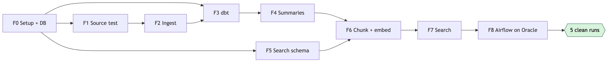

# Data Foundation Plan

Oct 29, 2026 · System: [01-system-overview.md](01-system-overview.md)

This phase gets ingestion → Postgres → summaries → chunks + bge-m3 → search running every weekday on Airflow for GOOG, META and RDDT. The report graph comes after.

## Done when

5 scheduled weekday runs in a row meet all of these:
- No manual fixes
- 0 missed 8-K or 10-Q filings for the 3 tickers, checked against EDGAR's filing list
- All dbt tests pass
- A run killed with `kill -9` during `process` and rerun ends with 0 duplicate rows. LLM calls repeat only for summaries that were in flight, at most 5
- All 25 test queries return an expected document in the top 8
- Each run takes under 10 min
- Ingest + summaries cost ≤ $0.02 a day

## Steps



F3 and F5 can start right after F0, using test data.

### F0 · Repo, environment, database

- Public repo `invest-agent`, Python 3.12, uv. Secrets, `private/`, data and logs are gitignored
- One `docker-compose.yml` for the laptop and the VM:
  - Airflow: scheduler, dag-processor, api-server
  - Airflow's Postgres 17
  - laptop only: `pgvector/pgvector:0.8.6-pg18` for app data
- Image: `apache/airflow:3.3.2` plus the app in `/opt/invest/.venv`. No model weights in the image
- Neon Free project: Postgres 18.6, pgvector 0.8.6 (checked Oct 29, 2026). Local and CI images match. Login roles `app_login` and `dbt_login` are created with SQL, because console-created roles get `neon_superuser`
- Plain SQL migrations in `src/invest_agent/db/migrations/NNNN_*.sql` (no Alembic, since there are no ORM models). `invest db migrate` applies each file once in its own transaction, under an advisory lock, and stops if an applied file's checksum changed. Applied files are recorded in `ops.schema_migrations`
- Roles `app`, `dbt` and `reader` ([ownership](01-system-overview.md#storage))
- `config/universe.yaml`: ticker, CIK, aliases, sectors
- `config/pipeline.yaml`: active chunker, embedding `model_key`, prompt and parser versions
- CLI: `db migrate`, `ingest`, `process`, `search`, `report`, `deliver`, `backup`, `db load-fixtures`
- Python tables use real PK, FK, unique and check constraints. Every output table has `run_id` and `created_at`
- CI: ruff, then pytest against a Postgres service container, then `invest db load-fixtures` and `dbt build` on the same container

**Done when**
- `docker compose up` on the laptop starts Airflow and both Postgres containers
- Running `invest db migrate` twice changes nothing
- The `dbt` role can't insert into `raw.documents`
- CI passes

### F1 · Test every source

Free-tier limits for most sources aren't documented well enough to plan around.

- `scripts/probe_sources.py` calls each source for the 3 tickers over the last 7 days and records:
  - the fields returned and the item count
  - full text or headline only
  - timestamp format
  - rate limits hit
  - terms of use
- News body test, on 100 real article candidates for the 3 tickers from Finnhub (Google News is blocked by robots.txt, GDELT returned 429). Run the full F2 fetch path and record:
  - per publisher: `body_status` share and failure reasons (403/429/451, paywall, JavaScript-rendered, empty extraction)
  - completeness: full article vs lead only, checked by hand on 30
  - correctness: main text rather than menus, ads or related links, checked by hand on 30
  - fetch and extraction time per article
  - for each major event in the window (earnings, guidance, 8-K), whether at least one quotable full-text source exists, either a filing or an article
- Call Finnhub's company-news endpoint and record the actual response fields
- Confirm that EDGAR's filing index gives 8-K Item numbers
- List which sources, if any, have earnings call transcripts
- **Content over 30 days**, measured on what we can read, not on API responses:
  - run every Finnhub item from the last 30 days through the fetch path (`probe_news_bodies.py backfill`)
  - dedupe: Finnhub id, headline, then text copies (8-word shingle containment ≥ 0.8 within 72 h)
  - article type by the page's provider: reporting, analysis or opinion, press release, auto-generated
- **Other news and analyst sources, with our keys** (results in `docs/source-probe.md`):
  - Alpaca News, Benzinga feed with `include_content=true`: kept, for the Benzinga bodies our fetch can't get
  - EODHD: dropped. One ticker per request at 10 calls, against 20 a day
  - FMP: dropped. The free plan covers META only
  - TipRanks MCP: dropped. Its terms forbid keeping data beyond a transient cache
  - GDELT: dropped. 429 on 9 of 10 requests, with backoff
- **Analyst reasons.** yfinance gives the rating and target changes but not the reasons. For each change in the 30 days, find an article from the same firm within −1 to +2 days and copy a sentence that names the firm and gives a reason. A sentence quoted in an article is not the broker's report. No match means no reason; the LLM never supplies one
- Alpha Vantage transcripts across several quarters and all 3 tickers, and the delay after each call
- Write the results to `docs/source-probe.md`. Pick the M1 sources in `config/sources.yaml`

**Done when**
- Every source has a measured result and a keep / drop / later decision
- Every 8-K the 3 tickers filed in the last 90 days can be fetched from EDGAR
- `docs/source-probe.md` has the per-publisher body table, and lists every major event that lacks a full-text source
- For GOOG, META and RDDT over the last 30 days, `docs/source-probe.md` reports:
  - readable news bodies after dedupe, per ticker
  - the `full` / `partial` / `headline_only` split
  - the share of reporting vs analysis vs press releases
  - the share of rating changes linked to a quoted reason, with examples and sources

### F2 · Ingestion

- Sources are called in parallel, one thread per source, each under its own rate limit. Body fetches run in parallel across hosts, one request at a time per host (`PoliteClient`). A failing source doesn't stop the others
- One connector per kept source. Each returns:
  ```python
  class RawDocument(BaseModel):
      source: str               # sec | ir_rss | finnhub | alpaca | alphavantage
      source_id: str            # accession no. + file, API id, or URL
      url: str
      title: str
      body: str | None
      body_status: Literal["full", "partial", "headline_only"]
      tickers_hint: list[str]   # what the source claims
      published_at: datetime    # UTC
      fetched_at: datetime
      raw: dict                 # API payload
  ```
- Before writing, set these fields:
  - Canonical URL: strip `utm_*`, `fbclid`, `gclid` and fragments, and turn AMP URLs back into the original
  - `doc_id`: `sha1(canonical URL)`, or `sec:<accession>:<file>` for SEC documents
  - Tickers and sectors, from `universe.yaml` aliases
  - `doc_type` (filing, press_release, news, transcript)
  - `source_rank`: filing 1, press release 2, wire service 3, other 4
  - For filings: `form_type`, `items`, `fiscal_period`
- A new migration replaces the `source` check on `raw.documents` (0003 lists `gnews` and `gdelt`) with the kept sources
- `raw.documents` is written with `ON CONFLICT DO NOTHING`. A new `document_versions` row is added only when the normalized text changes
- Each document keeps the source that found it, the original publisher (e.g. the provider of a Yahoo page), and the source's storage rule from `sources.yaml`. A source whose terms allow only transient caching is never written to `raw`
- News goes through two stages ([rules](01-system-overview.md#news-bodies)):
  - Discovery stores the title, URL, outlet, time and `feed_snippet`
  - `ingest` then fetches the publisher page, runs trafilatura and the completeness check, and sets `body_status` and `fetch_error`
- Release pages from IR RSS are fetched the same way. PDF releases go through a PDF text extractor
- HTML isn't stored, only the extracted text ([raw files](01-system-overview.md#storage))
- Each item is its own transaction. Counts and errors go in `ops.run_steps`, and every row gets the run's `run_id`
- Windows, not watermarks ([late arrivals](01-system-overview.md#late-arrivals)):
  - `ops.fetch_cursors` keeps each source's last successful run
  - each run asks for that time minus the source's `lookback` (in `sources.yaml`), up to now
  - a test fixture holds an item whose `published_at` is older than the last run but first appears now, and the run must store it
- Earnings calendar from Finnhub (free) and yfinance into `raw.earnings_calendar`: ticker, date, before or after market, `fetched_at`
- Record `created_at − published_at` for every document. For SEC, compare `created_at` with `acceptanceDateTime` to measure the submissions API's delay
- SEC: send a User-Agent, stay at or under 10 req/s, and fetch the 8-K main document plus Exhibit 99.1
- Finnhub items appear 2–5 hours after their timestamp, so every run asks for yesterday and today and dedupes on `id`
- Earnings call transcripts: Alpaca's same-day transcript first, Alpha Vantage's (1–8 days later) as a backup
- yfinance daily prices are upserted into `raw.prices_daily`
- `invest ingest --since 30d` runs the backfill. `invest ingest --sources sec,ir_rss,alpaca --tickers RDDT` is what `earnings_watch` calls
- Tests use saved API responses, not the network

**Done when**
- A 30-day backfill completes for every kept source, and a second run adds 0 rows
- One article saved three ways (AMP URL, UTM URL, the same URL refetched) is stored as 1 document, and changing its body adds a second version
- With one source's API key broken, the other sources still finish, and `ops.run_steps` records the failure
- Every news item ends as `full`, `partial` or `headline_only`. A failed fetch keeps its `fetch_error`, and a transient error is retried on the next run
- No 8-K or 10-Q in the window is missing compared with EDGAR's list
- A daily run takes under 3 min
- The late-arrival fixture is stored on the next run, and a report selects it by `created_at`

### F3 · dbt on Postgres

- dbt Core 1.12 + dbt-postgres, connecting as the `dbt` role. Layers and naming follow [Lineage](01-system-overview.md#lineage)
- Sources (`sources.yml`, read-only):
  - `docs` → `raw.documents`, `raw.document_versions`
  - `market` → `raw.prices_daily`
  - `config` → `raw.universe`
  - `content` → `content.*`
  - `ops` → `ops.*`
- Models for this phase:

  | Layer | Model | One row per |
  | --- | --- | --- |
  | Staging | `stg_docs__documents`, `stg_docs__versions` (no `text` column) | Document; version |
  | Staging | `stg_content__chunks`, `stg_content__document_events`, `stg_content__summaries` | Same as the source |
  | Staging | `stg_market__prices_daily` | Ticker × date |
  | Snapshot | `snap_universe` | Ticker × validity range |
  | Mart | `dim_companies` | Ticker |
  | Mart | `fct_document_coverage_daily` | Ticker × source × day (documents, full-text share, filings vs EDGAR) |
  | Mart | `fct_events` | Event (first seen, documents, outlets) |
  | Mart | `fct_source_lag_daily` | Source × day (documents, p50 and p95 of `created_at − published_at`) |

- Tests:
  - Postgres constraints already enforce keys, not-null and allowed values on Python tables, so source tests check only what a constraint can't: `tickers_in_universe`
  - Every full-text canonical document has chunks and an embedding for the active `model_key`
  - No copy shows up in `search_chunks`
  - `version.text[char_start:char_end] = chunk.text`
  - Every `report.claim_evidence` row resolves to its chunk or fact
  - `fct_source_lag_daily`: warn when a source's p95 passes 80% of its `lookback`
  - Each mart is unique on its declared grain
  - Warning: no ingest step failed for `var('run_id')`
- Contracts on every mart (names, types, not-null, primary key)
- Exposure `report_graph` (type `application`), depending on the marts it reads
- `dbt source freshness` runs as its own task after ingest, because `dbt build` doesn't run it. Only `raw.prices_daily` is checked (`fetched_at`, error after 30 h). News can legitimately be empty, so news sources are checked by the run-step test instead
- After each invocation, `run_results.json` goes to `ops.dbt_invocations` with the `run_id`. `manifest.json` is uploaded once per Git SHA
- A CI check fails any model that names `raw.`, `content.`, `ops.` or a dbt schema directly instead of using `source()`/`ref()`

**Done when**
- `dbt build` passes on the CI fixtures and on the 30-day backfill
- `dbt build --full-refresh` leaves the `raw` and `content` row counts unchanged
- `dbt ls -s +exposure:report_graph` lists every model the report reads
- A model with a hard-coded `raw.documents` fails CI
- Inserting a row that breaks a mart contract fails the build
- A build on 30 days of data takes under 60 s

`state:modified+` with `--defer` is worth adding only once a full build takes minutes. Even then it's for CI only, because it picks models by changed code, not by new data.

### F4 · Summaries

- `invest process` sends Haiku 5.5 every canonical current version that is `full` or `partial` and has no summary for the active `(model, prompt_version)`
- Haiku returns JSON: a 3-line summary plus tags from a fixed list (earnings, guidance, rating_change, m&a, legal, product, macro, other). Tokens and cost are stored on the row
- Summaries are for triage and report context only. They are never cited
- Up to 5 Haiku calls run at once. Each summary is written in its own transaction as its call returns, so a crash repeats only the calls in flight. A 429 backs off and retries

**Done when**
- A second run makes 0 API calls
- A changed body makes 1 call. A syndicated copy or a `headline_only` item makes 0
- 50 documents are summarized in under 1 minute
- At least 18 of 20 hand-checked summaries are accurate, with no made-up numbers
- A normal day (about 60 documents) costs $0.02 or less

### F5 · Search schema

- A migration creates `content.chunks`, `content.embeddings` (`dense halfvec(1024)`, `sparse sparsevec(250002)`) and the `content.search_chunks` view. The view holds chunks of each canonical document's current version, for the active chunker, joined to the document's filter columns and `event_id`
- bge-m3 sparse token IDs are stored +1, because `sparsevec` indexes start at 1
- Indexes:

  | Table | Index |
  | --- | --- |
  | `documents` | unique `(source, source_id)`, unique `canonical_url`, GIN `tickers` and `items`, btree `published_at` and `(form_type, fiscal_period)` |
  | `chunks` | unique `(version_id, chunker_version, ordinal)`, btree `embed_input_hash` and `item_code` |
  | `embeddings` | primary key `(input_hash, model_key)` |

- No vector index. Search is exact until the filtered p95 goes over 500 ms. If it does, add a partial HNSW index on the active `model_key` with `hnsw.iterative_scan = relaxed_order`, and move the filter columns onto the vector table

**Done when**
- Migrations pass locally and on Neon
- 100 real bge-m3 sparse outputs round-trip unchanged

### F6 · Chunking, embedding, copies, events

- The copy check runs first ([rules](01-system-overview.md#copies-and-events))
- Chunks follow the document type ([rules](01-system-overview.md#chunking))
- Lines that appear in 5 or more documents from the same publisher within 30 days are left out of chunks. This catches rotating promo blocks that the extractor's fixed list misses
- `embed_input_hash` = hash(context header + text). An existing embedding with the same hash and `model_key` is reused
- bge-m3 encodes dense and sparse in one call. The weights live on a VM volume:
  ```python
  out = model.encode(texts, batch_size=16, max_length=512, return_dense=True, return_sparse=True)
  # out["dense_vecs"] -> (n, 1024); out["lexical_weights"] -> [{token_id: weight}, ...]
  ```
- A document's chunks, new embeddings and event link go in one transaction, with the run's `run_id`
- A new embedding model writes under a new `model_key`. `pipeline.yaml` switches to it after the backfill

**Done when**
- A second run adds 0 chunks and 0 embeddings
- Bumping the chunker version re-embeds only the chunks whose input changed
- 30 labelled pairs (10 copies, 10 same-event, 10 unrelated):
  - at least 9 of the 10 copies are caught
  - no other pair is marked as a copy
  - at least 18 of the 20 non-copy pairs are grouped correctly
- 10 hand-checked table chunks carry the correct title, unit and periods
- The size estimate in 01 is replaced with the measured bytes per chunk
- A normal day embeds in under 4 min on the VM, including model load

If it's too slow, try these in order: a shorter `max_length` for news, then ONNX int8.

### F7 · Search

- `search_chunks(query, tickers, since, forms=None, items=None, period=None, k=8)`:
  ```sql
  WITH cand AS MATERIALIZED (
    SELECT c.chunk_id, c.event_id, e.dense, e.sparse
    FROM content.search_chunks c
    JOIN content.embeddings e
      ON e.input_hash = c.embed_input_hash AND e.model_key = :model_key
    WHERE c.tickers && :tickers AND c.published_at >= :since
      AND (:forms IS NULL OR c.form_type = ANY(:forms))
      AND (:items IS NULL OR c.items && :items OR c.item_code = ANY(:items))
      AND (:period IS NULL OR c.doc_type = 'news' OR c.fiscal_period = :period)
  ),
  d AS (SELECT chunk_id, row_number() OVER (ORDER BY dense <=> :q_dense) AS r
        FROM cand ORDER BY dense <=> :q_dense LIMIT 40),
  s AS (SELECT chunk_id, row_number() OVER (ORDER BY sparse <#> :q_sparse) AS r
        FROM cand WHERE (sparse <#> :q_sparse) < 0
        ORDER BY sparse <#> :q_sparse LIMIT 40)
  SELECT chunk_id, sum(1.0 / (60 + r)) AS rrf
  FROM (SELECT * FROM d UNION ALL SELECT * FROM s) x
  GROUP BY chunk_id ORDER BY rrf DESC LIMIT 24;
  ```
  Python then caps results at 2 per event and returns the top 8 with quote, URL, `doc_id`, `chunk_id` and `body_status`
- A filter parser for ticker aliases, forms, Items and periods
- Baseline `latest_by_ticker()` (newest documents, no vectors) for the M1 comparison, selected with `--retriever`
- `invest search "..." --tickers GOOG --since 14d` for checking results by hand
- `evals/retrieval_smoke.yaml`: 25 queries with expected `doc_id`s. 5 recent facts, 5 comparisons with last quarter, 5 thesis checks, 10 identifier and name queries
- `scripts/bench_search.py` writes `docs/search-bench.md`:

  | Variant | Answers |
  | --- | --- |
  | V1 dense only | Does sparse add anything once filters are on? |
  | V2 dense + sparse, k=60 | Default |
  | V3 dense + sparse, k=2 | Qdrant's default constant |
  | V4 dense + FTS, V5 dense + sparse + FTS | Does FTS replace or add to sparse? |
  | V2 with `vector` | Precision lost by `halfvec` |
  | V2 without the parser | What the parser contributes |

  Metrics: hit@8, MRR, distinct events in the top 8, p50/p95 latency from the VM to Neon (including the first query after scale-to-zero). V2 latency is also measured on 200k and 1M synthetic rows.

  V2 stays unless another variant hits at least 2 more of the 25 queries without losing any. If V1 ties V2, sparse is dropped. A 1-query difference is noise; the M3 30-question set makes the final call.

**Done when**
- All 25 queries have an expected document in the top 8
- "RDDT 8-K Item 2.02" returns the filing in the top 3
- No copy appears in results, and no event fills more than 2 of the top 8
- p95 latency is under 500 ms from the VM to Neon
- `docs/search-bench.md` records the decisions on sparse, FTS and `halfvec`

### F8 · Airflow on Oracle

- **VM and access**
  - Create an Always Free Ampere A1 VM (2 OCPU, 12 GB, Ubuntu ARM) in the home region, close to the Neon region
  - On "out of host capacity", try another availability domain or try again later
  - SSH by key only. The Airflow UI listens on localhost and is reached through an SSH tunnel
  - Runtime secrets (Neon, Anthropic, Gmail app password, LangSmith) live in `.env` on the VM
- **`morning_report` DAG**
  - `America/Toronto` cron `40 7 * * 1-5`, `catchup=False`, `max_active_runs=1`
  - Tasks: check (market day and not yet sent) → ingest → source freshness → process → dbt build → report → deliver
  - Each task runs `/opt/invest/.venv/bin/invest <step>` in a 1-slot `pipeline` pool
  - Retries: ingest and process 2, dbt build and deliver 0. `on_failure_callback` emails the task name and the tail of the log
- **`earnings_watch` DAG**
  - Started by `check` on days when `raw.earnings_calendar` has a tracked ticker
  - Every 10 minutes through the release window: `invest ingest --sources sec,ir_rss,alpaca --tickers <reporting>`. Finnhub runs every 30 minutes. Same lock and pool as the other DAGs
- **`backup` DAG**, weekly: `pg_dump -Fc` of `raw`, `content`, `ops` and `report` without the embeddings data, uploaded to Oracle Object Storage. The last 4 dumps are kept
- **`deploy.yml`**: after CI passes on `main`, SSH in, then `git pull`, `docker compose build`, `invest db migrate`, `docker compose up -d`
- Set a monthly spend limit in the Anthropic console

**Done when**
- A test of the DAG's timetable gives 07:40 Toronto on every weekday around the DST change on Mar 8, 2027
- A market holiday is skipped
- A manual CLI run started during a scheduled run exits on the lock
- A deliberately broken dbt test stops the run and sends the alert
- The latest backup restores into a fresh local database, and `dbt build` passes on it
- Replaying Oct 29 (RDDT, results at 16:08 ET) puts the 8-K, the release and Alpaca's headlines in the database by 16:20, and the Finnhub articles in the next run after they appear
- A push to `main` deploys with no manual steps
- VM memory use stays above 20% over 7 days, so the VM doesn't count as idle
- A run takes under 10 min

Then start the 5-run check at the top.

## Files this phase adds

```
invest-agent/
├── .github/workflows/{ci,deploy}.yml
├── Dockerfile · docker-compose.yml · pyproject.toml
├── airflow/dags/{morning_report,backup}.py
├── config/{universe,sources,pipeline}.yaml
├── dbt/models/{staging,intermediate,marts}/ · dbt/snapshots/ · dbt/tests/ · dbt/models/exposures.yml
├── src/invest_agent/{cli.py, db/migrations/, ingest/, process/, search/}
├── evals/{retrieval_smoke,dedup_pairs}.yaml
├── tests/fixtures/
└── scripts/{probe_sources,bench_search}.py
```

## After the foundation

**Rest of M1:**
- Cards for GOOG, META and RDDT, plus `investment_policy.md`, kept in `private/` and synced to `raw.thesis_versions` with `invest theses sync`
- Ledger import into `raw.ledger_entries`, and `holdings()`
- 8-K table parser for revenue and EPS, writing to `content.extracted_facts`
- Financial models ([rules](01-system-overview.md#lineage)):
  - `stg_content__extracted_facts` → `int_financial_facts_unioned` → `int_financial_facts_resolved` → `int_financial_periods_compared` → `fct_financial_metrics`, with a contract, used by `facts_lookup(as_of)`
  - dbt unit tests mock the inputs for these cases: an amended filing, GAAP and non-GAAP values for the same period, quarter vs YTD, Q4 derivation, thousands vs millions, the same value from XBRL and from the 8-K, and an amendment filed after a report's `as_of`
- Report graph with the fact check, saving sentences, claims and evidence. A pytest checks that an old report's evidence still resolves after new versions and a rechunk
- Email delivery ([rules](01-system-overview.md#delivery)), including a test of the IMAP Sent Mail check
- A 2-week pilot against the baseline retriever

The M1 gate:
- 0 missed filings
- an average clarity score of at least 4/5
- every report on time
- $0.15 or less per report
- every major event in a report (earnings, guidance, 8-K) cites at least one `full` source

**Later milestones:**
- **M2:** close and after-hours DAGs (on earnings days the close DAG's sensor, in reschedule mode, waits until 16:25 for the 8-K or the release), 16 tickers, XBRL facts (`stg_sec__xbrl_facts`, joining `int_financial_facts_unioned`), ledger (`stg_broker__ledger_entries` → `int_positions_rolled_up_daily` → `fct_portfolio_daily`, one row per account × date × ticker × valuation currency)
- **M3:** 30-question eval set, Anthropic vs OpenAI, reranker, final retrieval variant
- **M4:** earnings report, portfolio analysis, MCP server (`reader` role, exposure `mcp_server`)
- **M5:** admin UI and website reading `marts` and `report.*` (exposure `website`)

## Open decisions

| Decision | Settled by |
| --- | --- |
| Add a paid full-text news source | A report misses an event that only paid sources cover |
| Tickers for holdings, watchlist and the 4 sectors | Before M2. US listings fit as-is. Each ticker adds article fetches, at about 25 a minute from Yahoo |
| Copy containment threshold (start 0.8), event cosine threshold (start 0.9) | F6 pairs |
| PyTorch or ONNX for bge-m3 | F6 timing |
| Sparse vs FTS, `halfvec` vs `vector`, RRF k | F7 benchmark |
| Neon Free → Launch | Measured storage passes 0.8 GB |
| Keeping the Oracle VM from counting as idle. Idle containers measured about 0.85 GB on the laptop, 7% of 12 GB and under the 20% threshold | F8: first check whether a Pay As You Go upgrade exempts it |

## Not yet verified

| Item | Checked in |
| --- | --- |
| Finnhub's and Benzinga's terms of use (not found or not read in F1) | Before M1 |
| Alpha Vantage transcript delay after a call (1–8 days in F1) | F2 |
| Which constraints Postgres enforces in a dbt contract (the docs table was read by tab order) | F3 |
| `sparsevec(250002)` storing bge-m3 output (the README gives no storage limit) | F5 |
| bge-m3 speed on 2 ARM OCPUs | F6 |
| Whether Oracle sign-up needs a card, and whether a Pay As You Go upgrade prevents idle reclamation (oracle.com/cloud/free returned 403) | Before F8 |
| Gmail IMAP `X-GM-RAW` search with `rfc822msgid:` | M1 delivery |
